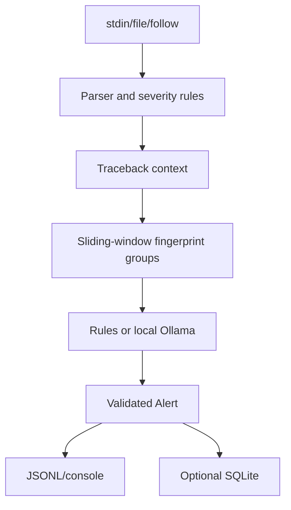

# Smart Local Log & Error Triage Engine

[GitHub repository](https://github.com/yashr5120/LogTriage)

An offline-first Python service that turns noisy application logs into grouped,
redacted, structured diagnostic alerts. Rules work without Ollama; an installed
local Gemma model is optional and never receives a cloud request.

## Features

- Streaming stdin, regular-file, and `tail -f`-style file ingestion.
- Case-insensitive severity rules with JSON and timestamped-text parsing.
- Bounded traceback/context assembly and stable fingerprint deduplication.
- Cooldown and severity escalation handling.
- Ollama `/api/generate` integration with strict validation and rules fallback.
- JSONL or human-readable output and optional SQLite history.
- Deterministic demo scenarios and machine-readable benchmark metrics.



## Install and run

```powershell
py -m venv .venv
.venv\Scripts\Activate.ps1
pip install -e ".[dev]"
logtriage demo --scenario database-failure --output jsonl
logtriage run --input examples\sample.log --rules-only --output jsonl
```

On Linux/macOS use `python3 -m venv .venv`, `source .venv/bin/activate`, and
replace path separators with `/`. Piped input is supported:

```powershell
Get-Content examples\sample.log | logtriage run --input - --rules-only --output jsonl
```

## Local Gemma mode

Install Ollama separately, then explicitly install a compatible local model:

```text
ollama pull gemma2:2b
logtriage run --input examples\sample.log --output jsonl
```

Set `LOGTRIAGE_OLLAMA_HOST`, `LOGTRIAGE_OLLAMA_MODEL`, or provide a YAML file
with `--config`. `logtriage doctor` reports connectivity, installed model
metadata, and quantization when Ollama is available. The runtime never pulls
models automatically. If Ollama is unavailable or returns invalid JSON, the
event is emitted with a rules-based fallback status.

## Commands

```text
logtriage run --input PATH|- [--rules-only] [--output console|jsonl]
logtriage follow --input PATH [--rules-only]
logtriage demo --scenario database-failure|traceback|startup|oom
logtriage doctor
logtriage validate-config
logtriage benchmark --repeat 100
```

Application diagnostics go to stderr; JSONL stdout remains parseable. Redaction
is applied before inference and persistence, but regex redaction cannot guarantee
that every possible secret is removed. Logs are untrusted data and are wrapped
as data in the model prompt; the model has no tools or remediation permissions.

## Development

```powershell
pytest
ruff check src
mypy src
logtriage benchmark --repeat 1000 > benchmark.json
```

Benchmark output reports observed values only: line counts, candidate counts,
deduplication, alerts, throughput, inference latency, and environment. It does
not promise hardware-independent performance.

## Limitations and future work

The current prototype has one synchronous inference path per pipeline and does
not yet include platform-specific journald/syslog adapters, notification
integrations, or retention cleanup for SQLite. Follow mode is intentionally
blocking and should be run as a service under an external supervisor.

## License

MIT; see [LICENSE](LICENSE).
